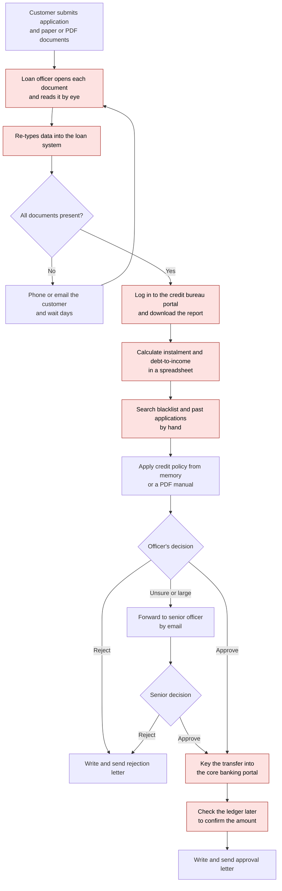
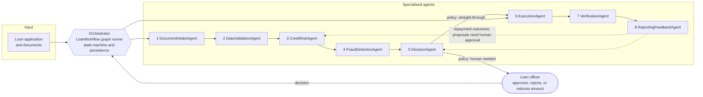
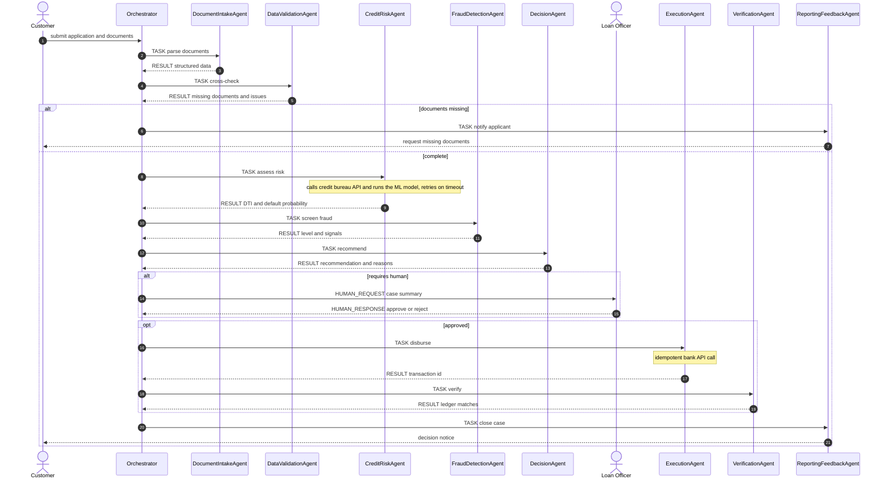
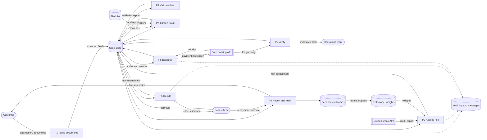
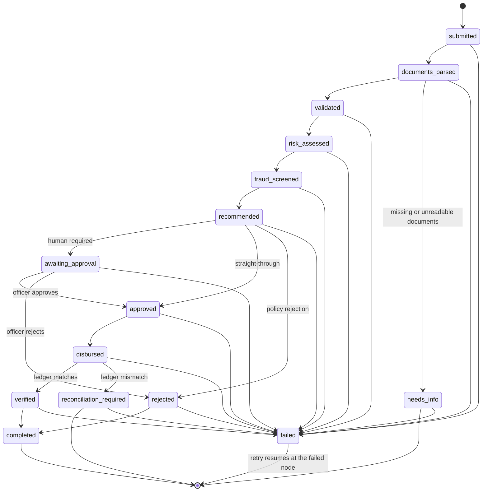
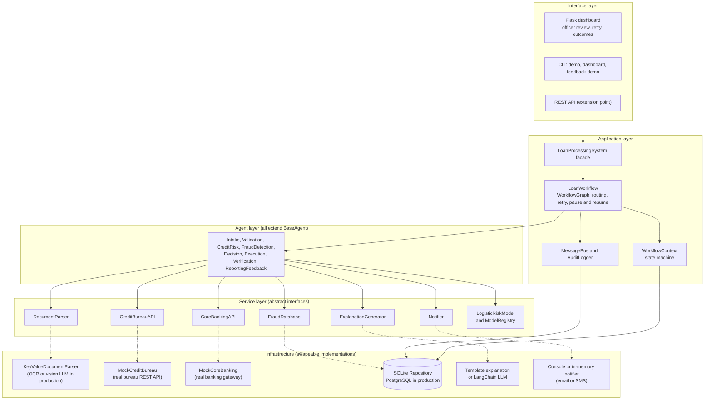
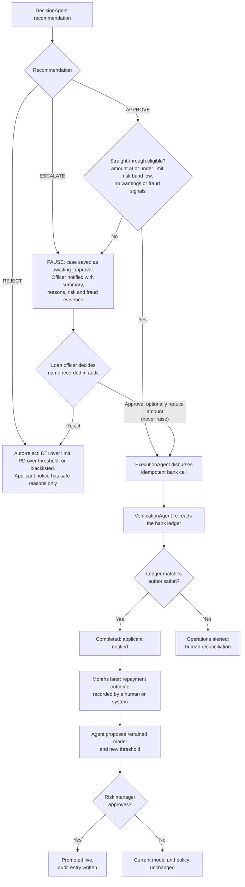
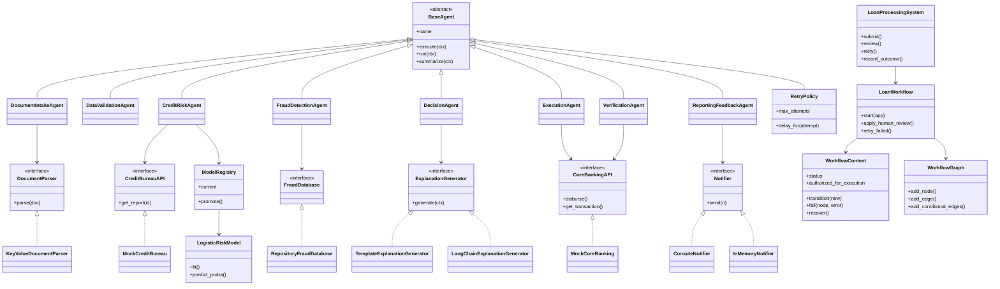

# Architecture and Diagrams

All diagrams are Mermaid. They render on GitHub, in VS Code (Markdown Preview Mermaid
Support extension), and in `docs/diagrams.html` (open it in a browser; it needs internet
to load the Mermaid library).

The diagrams match the code: the state diagram mirrors the transition table enforced in
`loan_system/state.py`, and the agent order matches `loan_system/orchestrator.py`.

---

## 1. Existing process (manual)

Red boxes are the repetitive, error-prone steps (re-typing, spreadsheet maths, manual
look-ups, manual payment keying). The judgement steps (`Officer's decision`,
`Senior decision`) stay with humans in the new design.

---

## 2. Proposed multi-agent architecture

Agents never call each other. Each reads the shared case, writes only its own section,
and returns control to the orchestrator.

---

## 3. Agent communication flow (one case, human-approved path)

Every TASK, RESULT, HUMAN_REQUEST and HUMAN_RESPONSE is stored as an `AgentMessage` and
shown in the dashboard under "Agent conversation".

---

## 4. Data flow diagram

---

## 5. State diagram

Two rules the code enforces: no state can be skipped (`IllegalTransition`), and money only
moves from `approved`, which is reachable only through a human review or a policy-approved
straight-through case. Any non-final state can move to `failed` (for example if the closing
report step itself breaks), and a retry resumes at the node that failed.

---

## 6. System architecture (layers)

---

## 7. Human-in-the-loop workflow

Humans appear at four points: the approval gate, reconciliation of ledger mismatches,
retrying failed cases, and approving any model or policy change.

---

## 8. Class diagram (OOP design)

